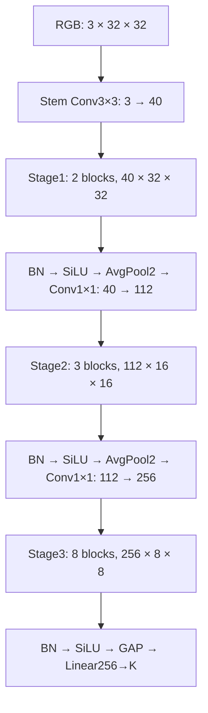

# CompactMix-L: CIFAR-10 and CIFAR-100

A compact CNN trained from scratch for 32×32 image classification. This repository contains one complete training script, one evaluation script, and measured experiment records. The model stays below **6 million learnable parameters and 1 GFLOP per image**.

| Dataset | Parameters | GFLOPs / image | Best validation | Test accuracy |
|---|---:|---:|---:|---:|
| CIFAR-10 | 5,248,172 | 0.842406944 | 97.56% | **97.18%** |
| CIFAR-100 | 5,271,302 | 0.842453114 | 83.36% | **82.98%** |

These are single-seed results from **45,000 training / 5,000 validation images**, followed by evaluation of the validation-selected EMA checkpoint on all 10,000 official test images. Both selection runs completed 600 epochs; best epochs were 567 and 399. They are **not** full-50k retraining results.

## Repository layout

```text
train.py                 # Explicit Conv/forward, data, train/resume/final evaluation
evaluate.py              # Load best weights and evaluate both test sets
requirements.txt         # Runtime dependencies; no environment creation
tests/                   # Model, checkpoint, resume and evaluation checks
results/                 # Configs, splits, full histories and measured metrics
  cifar10/
  cifar100/
  quick_comparison/      # Seven short, controlled CIFAR-10 recipe comparisons
checkpoints/             # Local only: original best.pt / last.pt and new runs
datasets/                # Local only: official CIFAR data
```

Dataset files and checkpoint binaries are excluded from Git. A fresh clone contains code and measured records, but **no pretrained weights**. Train your own weights, or copy the recorded checkpoints into the paths in [results/checkpoints.json](results/checkpoints.json). No public weight-download URL is currently provided.

## Requirements

Recorded environment: Windows, Microsoft Store Python 3.13.14, PyTorch 2.7.1+cu118, torchvision 0.22.1+cu118, NumPy 2.2.6 and RTX 4060 Laptop GPU. The project enforces the maintainer's existing **Microsoft Store Python 3.13 base installation**, without virtual environments or alternate interpreters; its location is resolved from `%LOCALAPPDATA%`.

Use the existing CUDA-enabled PyTorch. Install only missing dependencies into that same interpreter; the requirements file does not select or replace a CUDA wheel source:

```powershell
& "$env:LOCALAPPDATA\Microsoft\WindowsApps\python3.13.exe" -m pip install -r requirements.txt
```

`tensorboard` is needed for saved runs that enable it; new runs disable it by default. Tests additionally require `pytest` in the same interpreter.

## Training

Start the full two-dataset selection → frozen retraining → final evaluation workflow:

```powershell
& "$env:LOCALAPPDATA\Microsoft\WindowsApps\python3.13.exe" -X utf8 -u train.py --download
```

With datasets already present, `python3.13.exe -u train.py` is sufficient. Full training takes hours. To train/validate without retraining or opening official test:

```powershell
& "$env:LOCALAPPDATA\Microsoft\WindowsApps\python3.13.exe" -X utf8 -u train.py --dataset both --selection-only --run-name experiment_01
```

All 13 explicit blocks and forward passes are in `train.py`. Edit layer arguments manually when changing the architecture, then check connections and budgets:

```powershell
& "$env:LOCALAPPDATA\Microsoft\WindowsApps\python3.13.exe" -X utf8 train.py --check --dataset both
```

For a **synthetic pipeline check**, not a CIFAR accuracy measurement:

```powershell
& "$env:LOCALAPPDATA\Microsoft\WindowsApps\python3.13.exe" -X utf8 -u train.py --smoke --dataset both --epochs 2 --run-name smoke_01
```

Each run retains exactly `best.pt` and `last.pt`. Training prints one summary only after a complete training/validation epoch and successful writes. `best` uses validation accuracy; `last` restores model, EMA, optimizer, AMP scaler, RNG and history. In full-training mode, `best` represents the fixed epoch without validation selection.

Repeat the same command to resume. First Ctrl+C finishes/saves the epoch; a second interrupts immediately and the unfinished epoch is replayed. Use `--stop-after-epochs 1` for one additional epoch without changing the total schedule. Source/config/runtime changes require a new run name.

### Preserved local runs

Original checkpoint bytes were preserved. A local compatibility receipt pins their hashes and the new trainer source; old tensor names are mapped without changing values. Verify a saved run without training or writes:

```powershell
& "$env:LOCALAPPDATA\Microsoft\WindowsApps\python3.13.exe" -X utf8 train.py --resume-run checkpoints/default_cifar10_compactmix_sgd_lr0.1_seed42 --verify-resume
```

`--resume-run` uses the saved configuration and requires the matching runtime. Do not move a run's folder or edit the trainer before exact resume. Compatibility does not bypass mismatches for arbitrary checkpoints.

## Test evaluation

Evaluate the two recorded local best checkpoints:

```powershell
& "$env:LOCALAPPDATA\Microsoft\WindowsApps\python3.13.exe" -X utf8 evaluate.py
```

For new weights, supply actual paths:

```powershell
& "$env:LOCALAPPDATA\Microsoft\WindowsApps\python3.13.exe" -X utf8 evaluate.py --checkpoint-cifar10 'path/to/cifar10/best.pt' --checkpoint-cifar100 'path/to/cifar100/best.pt'
```

For one dataset: `evaluate.py --dataset cifar10 --checkpoint 'path/to/best.pt'`. Evaluation uses `eval()`, no gradients, only tensor conversion/normalization, strict weight loading and all 10,000 test images. Console output includes top-1/top-5 accuracy, correct/total, loss, macro-F1 and checkpoint path. JSON/CSV outputs go to `results/test_runs/` (Git-ignored). Smoke/subset checkpoints are rejected.

## Architecture and recipe



Each block uses BN/SiLU, pointwise expansion, split depthwise3×3/5×5 branches, concatenation, grouped3×3 convolution (`groups=8`), SE, pointwise projection and a DropPath residual. Two transition pools perform downsampling.

Recorded recipe: SGD, base LR 0.1, momentum 0.9, Nesterov, weight decay0.0005 for multidimensional parameters, batch 128, five-epoch warmup and per-batch cosine decay. AutoAugment, Mixup/CutMix, smoothing 0.05, EMA up to 0.999 and grad-norm clipping 5 are enabled. DropPath increases0→0.1 by block depth. Seed42; stratified split seed 2026. Adam/AdamW are supported, but no completed full-data Adam comparison is claimed.

FLOP convention: one Conv/Linear MAC equals two operations, with additional bias, BN, activation, pooling, SE multiplication and residual-add costs. Input is one RGB 32×32 image. These are analytical inference estimates, not training costs or measured latency.

## Evidence and limitations

- [CIFAR-10](results/cifar10/) and [CIFAR-100](results/cifar100/) records: exact split indices, settings, full histories, test confusion matrices and per-class metrics.
- [Test summary](results/test_summary.csv): checkpoint-linked test results.
- [Quick recipe comparisons](results/quick_comparison/README.md): seven5-epoch runs on 5,000 train/1,000 validation images. These are subset validation results, not test scores or evidence of the best 600-epoch recipe.

Architecture, augmentation, EMA and duration all contribute to results. There is no controlled evidence for every individual block choice, no multi-seed accuracy estimate, and no novelty/uniqueness claim. Select models with validation, freeze decisions, then perform final retraining/evaluation; do not tune using test scores.

## Checks and contributions

```powershell
& "$env:LOCALAPPDATA\Microsoft\WindowsApps\python3.13.exe" -X utf8 -m pytest -q
```

Tests cover shapes/budgets, invalid manual edits, epoch durability, optimizer/RNG/EMA resume equivalence, audited legacy migration and evaluation exports. Runtime tests use the required local interpreter. GitHub Actions checks repository hygiene without installing another Python environment.

Contributions: open an issue or focused pull request, preserve validation/checkpoint semantics, run the checks, and disclose dataset, seed, budget and provenance for new results. Do not submit datasets, weights, secrets or machine-specific config.

## References and license

- [CIFAR](https://www.cs.toronto.edu/~kriz/cifar.html)
- [Identity Mappings in Deep Residual Networks](https://arxiv.org/abs/1603.05027)
- [Squeeze-and-Excitation Networks](https://arxiv.org/abs/1709.01507)
- [Deep Networks with Stochastic Depth](https://arxiv.org/abs/1603.09382)
- [AutoAugment](https://arxiv.org/abs/1805.09501), [Mixup](https://arxiv.org/abs/1710.09412), [CutMix](https://arxiv.org/abs/1905.04899)

Copyright 2026 anhnam26. Project code: [Apache-2.0](LICENSE). CIFAR and dependencies retain their own terms; this license does not relicense third-party data/libraries.
