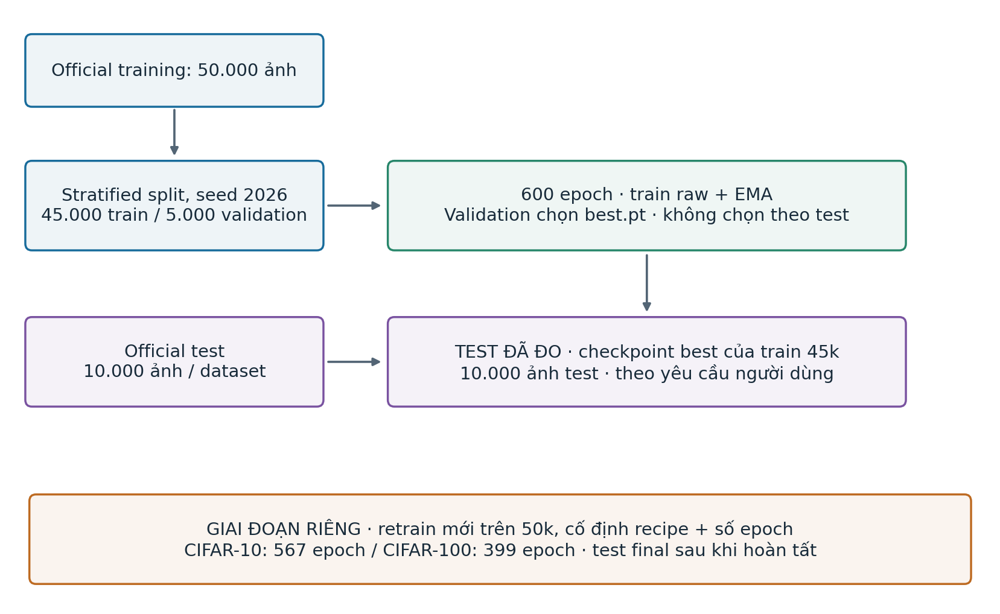
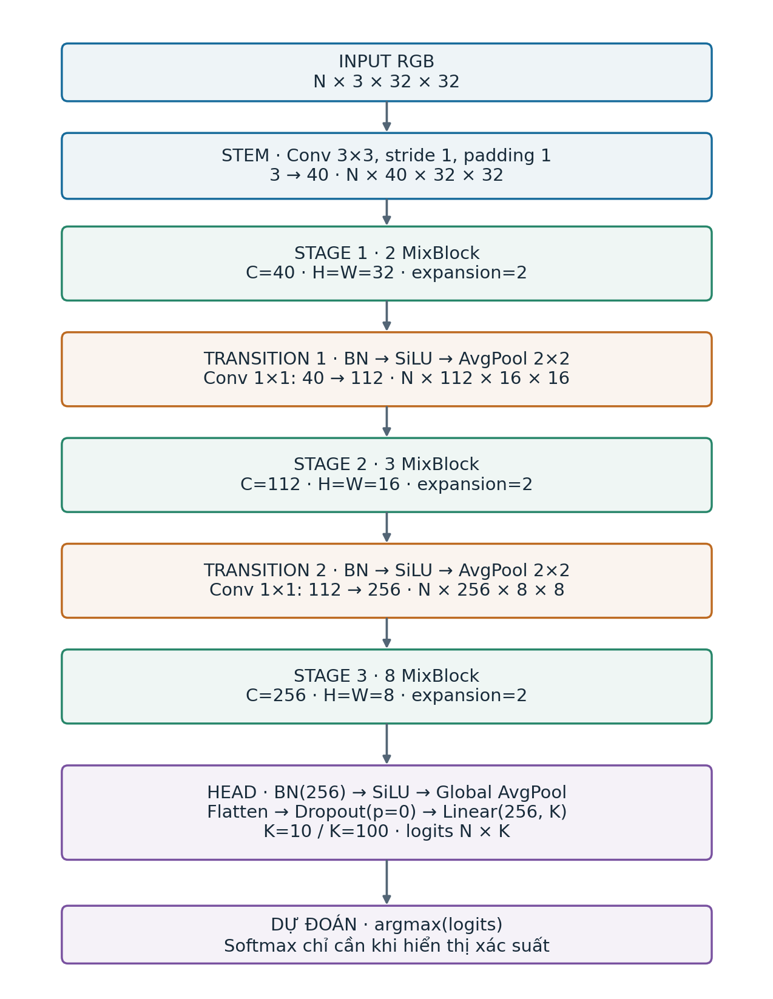
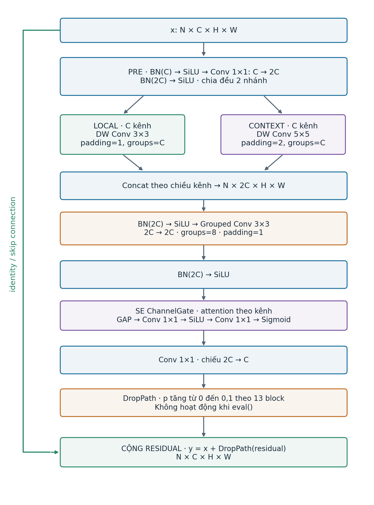
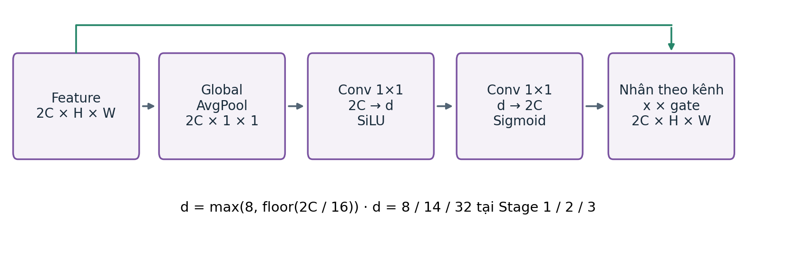
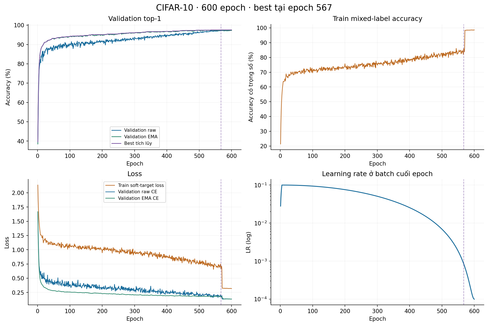
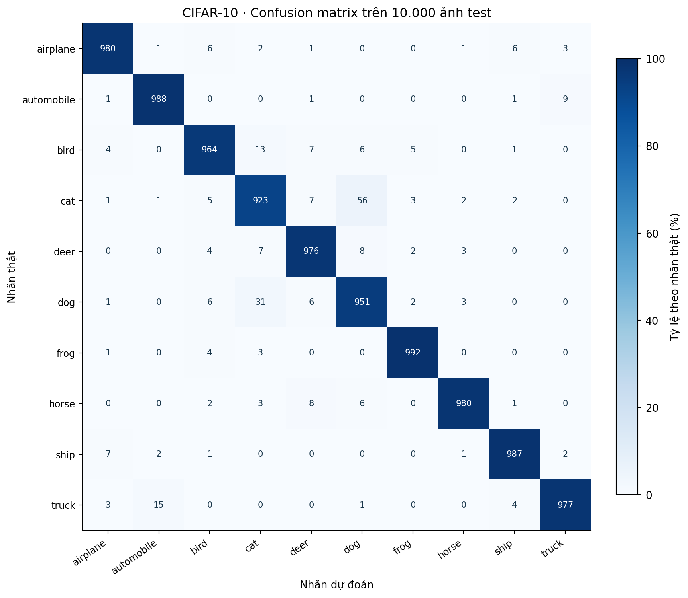
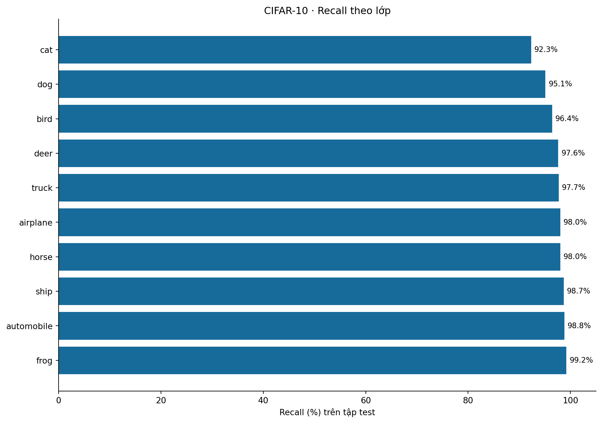
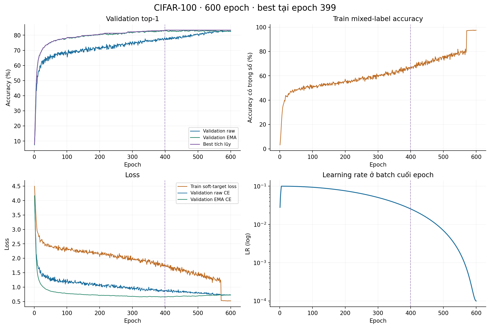
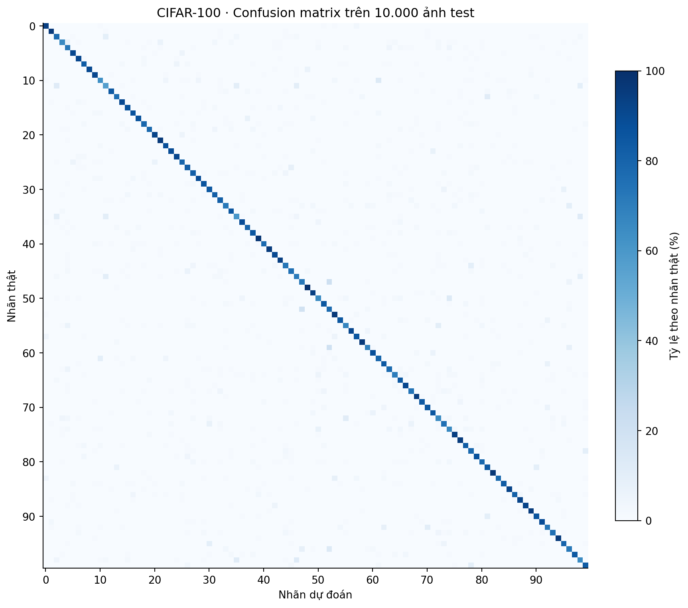
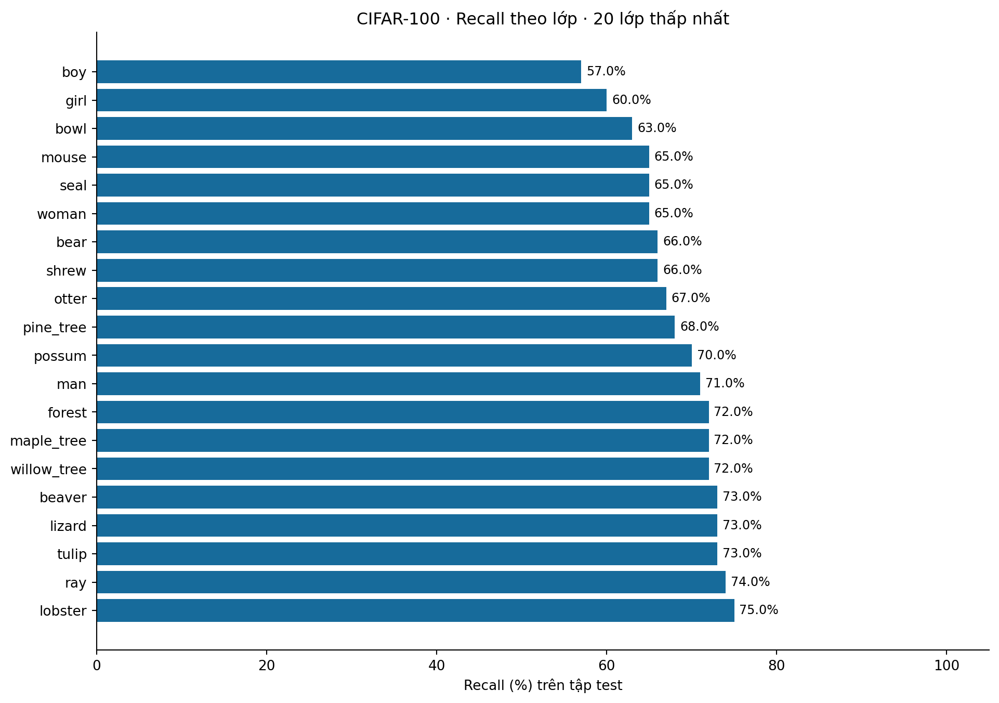

# Báo cáo bài làm: CompactMix-L trên CIFAR-10 và CIFAR-100

Thời điểm tổng hợp: 14/10/2026 13:56:14 (UTC+7).

Bản PDF để nộp; bản DOCX để điền tên/lớp và chỉnh sửa.

## Tóm tắt kết quả đã hoàn thành

Đề tài: thiết kế và huấn luyện mô hình nhẹ CompactMix-L từ đầu trên CIFAR-10 và CIFAR-100. Hai thí nghiệm selection đã hoàn thành 600 epoch trên 45.000 ảnh train và 5.000 ảnh validation. Các checkpoint best được chọn theo validation; tập test chính thức có 10.000 ảnh mỗi dataset.

| Thông tin | CIFAR-10 | CIFAR-100 |
| --- | --- | --- |
| Best validation top-1 | 97,56% | 83,36% |
| Test top-1 đã đo (best train 45k) | 97,18% (9.718/10.000) | 82,98% (8.298/10.000) |
| Epoch / loại trọng số | 567 / EMA | 399 / EMA |
| Tham số học được | 5.248.172 | 5.271.302 |
| FLOPs ước lượng / ảnh | 842.406.944 | 842.453.114 |
| Optimizer / LR ban đầu | SGD / 0,1 | SGD / 0,1 |

Các giá trị test trên thuộc checkpoint được train trên 45k, được đo theo yêu cầu người dùng. Chúng không phải kết quả của bản retrain trên 50k. Không có pretrained, ensemble, test-time augmentation hay dữ liệu ngoài trong hai lần đo.

Báo cáo là ảnh chụp trạng thái tại 14/10/2026 13:56:14 (UTC+7). Mã nguồn, log, cấu hình, chỉ số theo lớp, checkpoint best và hash đi kèm trong thư mục report.

## 1. Đề bài và mức độ đáp ứng

Nguồn yêu cầu: Final exam.docx, đính kèm nguyên bản trong evidence/. Đề yêu cầu một model L nhẹ, không quá 6M tham số, FLOPs dưới 1G; train/test trên cả hai dataset với nhiều learning rate ban đầu và cả SGD, Adam; nộp báo cáo PDF.

| Yêu cầu | Bằng chứng / trạng thái |
| --- | --- |
| <= 6.000.000 tham số | Đạt cho cả hai head; đếm trực tiếp model.parameters(). |
| < 1.000.000.000 FLOPs | Đạt theo phép đếm inference được mô tả tại mục 4. |
| Train và test CIFAR-10 / CIFAR-100 | Đã hoàn thành selection 45k/5k và test best trên đủ 10k ảnh mỗi dataset. |
| So sánh SGD, Adam và nhiều LR | CHƯA HOÀN THÀNH: mới có hai run full-data SGD, LR=0,1. |
| Báo cáo PDF | Bao_cao_CIFAR10_CIFAR100.pdf trong gói này. |
| Tính khác biệt kiến trúc giữa nhóm | Tự triển khai kết hợp các khối chuẩn; chưa có bằng chứng kiểm tra trùng với nhóm khác. |

Không điền các điểm số còn thiếu bằng mục tiêu. Các mục tiêu nghiên cứu 98% / 90% không phải điểm số đã đạt, cũng không phải ngưỡng bắt buộc trong văn bản đề bài.

Tiêu chí chấm: vấn đáp 30%, hiệu năng CIFAR-10 30%, hiệu năng CIFAR-100 30%, chất lượng báo cáo 10%. Đề lưu ý phải vượt qua vấn đáp; kiến trúc không được trùng nhóm khác.

## 2. Dữ liệu và giao thức thực nghiệm

| Thuộc tính | CIFAR-10 | CIFAR-100 |
| --- | --- | --- |
| Ảnh đầu vào / nhãn | RGB 32×32 / 10 lớp | RGB 32×32 / 100 fine classes |
| Official train / test | 50.000 / 10.000 | 50.000 / 10.000 |
| Selection train / validation | 45.000 / 5.000 | 45.000 / 5.000 |
| Số train / val / test mỗi lớp | 4.500 / 500 / 1.000 | 450 / 50 / 100 |
| Seed khởi tạo / split | 42 / 2026 | 42 / 2026 |
| Mean RGB | 0,4914; 0,4822; 0,4465 | 0,5071; 0,4867; 0,4408 |
| Std RGB | 0,2470; 0,2435; 0,2616 | 0,2675; 0,2565; 0,2761 |



Sơ đồ dữ liệu: tách selection và retrain final; test 45k được đo riêng.

Split được lấy phân tầng từ official training, không giao nhau và phủ đủ 50.000 chỉ số. File split.json lưu đầy đủ index cùng SHA256, có thể kiểm tra lại từng ảnh thuộc phần nào.

Train sử dụng RandomCrop(32, padding=4, padding_mode='reflect'), RandomHorizontalFlip, AutoAugment policy CIFAR10 trên cả hai dataset, rồi ToTensor và Normalize. Validation/test chỉ ToTensor và Normalize; không crop/flip ngẫu nhiên.

Chỉ số đánh giá: top-1=100·số dự đoán đúng/N; top-5=100·số mẫu có nhãn thật trong 5 logits cao nhất/N. Theo từng lớp: precision=TP/(TP+FP), recall=TP/(TP+FN), F1=2·precision·recall/(precision+recall). Macro-F1 là trung bình F1 không trọng số trên K lớp. Confusion matrix dùng hàng là nhãn thật, cột là nhãn dự đoán; mỗi ảnh được đánh giá đúng một lần.

Ban đầu chọn kiến trúc, recipe và best bằng validation. Sau selection, hai bản best 45k đã được đánh giá test theo yêu cầu người dùng. Vì test đã được mở, mọi thay đổi tiếp theo dựa trên điểm test sẽ không còn đáp ứng giao thức test giữ kín ban đầu. Báo cáo này không tuyên bố đã thực hiện ablation hay tối ưu thêm dựa trên test.

## 3. Kiến trúc tổng thể CompactMix-L



Sơ đồ model thực tế; cùng backbone, head khác số lớp.

| Khối | Output (bỏ chiều batch) | Chi tiết |
| --- | --- | --- |
| Input | 3×32×32 | RGB |
| Stem | 40×32×32 | Conv 3×3, stride=1, padding=1, không bias |
| Stage 1 | 40×32×32 | 2 MixBlock |
| Transition 1 | 112×16×16 | BN40 → SiLU → AvgPool2 → Conv1×1(40,112) |
| Stage 2 | 112×16×16 | 3 MixBlock |
| Transition 2 | 256×8×8 | BN112 → SiLU → AvgPool2 → Conv1×1(112,256) |
| Stage 3 | 256×8×8 | 8 MixBlock |
| Head | 256 → K | BN256 → SiLU → GAP → Dropout(0) → Linear |
| Logits | K=10 / K=100 | Không softmax trong forward; argmax cho top-1 |

Stem giữ nguyên độ phân giải 32×32; model chỉ giảm kích thước không gian hai lần. Khối cuối rộng hơn để biểu diễn thông tin khi H,W nhỏ. Ý tưởng là phối hợp nhiều thang không gian trong một block và chia sẻ cùng backbone cho hai dataset.

## 3.1. Cấu trúc MixBlock



Luồng tensor trong MixBlock; C giữ nguyên trước và sau residual.

| Stage | C / 2C / H=W | Grouped conv | SE hidden d |
| --- | --- | --- | --- |
| 1 | 40 / 80 / 32 | groups=8; 10 kênh/group | 8 |
| 2 | 112 / 224 / 16 | groups=8; 28 kênh/group | 14 |
| 3 | 256 / 512 / 8 | groups=8; 64 kênh/group | 32 |

Sau Conv1×1 mở rộng C→2C, chunk chia thành hai tensor C kênh. Nhánh local dùng depthwise 3×3; nhánh context dùng depthwise 5×5. Concat trả về 2C kênh; grouped 3×3 trộn theo 8 nhóm. SE tạo trọng số kênh; Conv1×1 cuối chiếu về C để cộng với x.

Công thức forward: u=Pre(x); (a,b)=chunk(u,2); r=Project(SE(ActNorm(GroupConv(Concat(DW3(a),DW5(b)))))); y=x+DropPath(r). Phương trình r là mô tả rút gọn; thứ tự BN/SiLU đầy đủ nằm trong sơ đồ và code.

Depthwise giảm chi phí xử lý không gian nhưng không tự trộn kênh; grouped convolution trộn trong từng nhóm, còn Conv1×1 dense trộn tất cả kênh. Vì không có ablation full-data, chưa thể định lượng riêng mức cải thiện accuracy do nhánh 5×5, SE hoặc DropPath.

## 3.2. SE, residual và các kiểu convolution



SE xử lý tensor 2C kênh, không phải C kênh.

SE: z=GAP(x), g=sigmoid(W2·SiLU(W1·z)), output=x·g; d=max(8,floor(2C/16)). Hai Conv1×1 của SE có bias. Sigmoid cho hệ số trong (0,1).

| Kiểu Conv | Cách hoạt động / vai trò |
| --- | --- |
| Dense 3×3 | Stem: mỗi output channel kết nối với tất cả input channels. |
| Pointwise 1×1 | Mở rộng/chiếu kênh, transition và hai lớp SE. |
| Depthwise 3×3 / 5×5 | groups=C trên tensor nhánh C kênh; một filter trên mỗi kênh. |
| Grouped 3×3 | 8 nhóm trên tensor 2C kênh; giữ H,W bằng padding=1. |
| Residual identity | Đường x không đổi kích thước; cộng với nhánh r. |
| DropPath | Trong train: bỏ toàn bộ residual của một mẫu theo xác suất p; eval: identity. |

13 block có drop probability p_i=0,1·i/12 (i=0..12). residual_scale=1, context_kernel=5, expansion=2, attention='se', norm='bn', activation='silu', stem='simple', pool='avg', dropout=0 là các mặc định đã dùng. BN sử dụng eps=1e-5 và momentum=0,1 theo mặc định PyTorch.

Model hỗ trợ tùy chọn ECA/không attention, BN/GN/GroupNorm(1,C), kernel context 3/5/7, pool avgmax và stacked stem; các biến thể này chưa có kết quả full-data trong báo cáo. Các mạng ResidualNet, PreActBlock, CIFARConvNeXt và adapter timm có source đi kèm, nhưng không phải model tạo ra các điểm số đang báo cáo.

## 4. Tham số, FLOPs và bảng layer

| Dataset | Parameters | MACs | FLOPs | GFLOPs |
| --- | --- | --- | --- | --- |
| CIFAR-10 | 5,248,172 | 409,492,864 | 842,406,944 | 0.842407 |
| CIFAR-100 | 5,271,302 | 409,515,904 | 842,453,114 | 0.842453 |

Đã tạo lại model trên CPU, load đúng best weights, forward input [1,3,32,32], đếm lại parameters và profile; các giá trị trùng metadata gốc. Bảng đầy đủ từng layer, input/output shape, kernel, stride, padding, groups và parameters nằm ở evidence/cifar10/layers.csv và evidence/cifar100/layers.csv.

Conv2d: P=Cout·(Cin/groups)·kh·kw + bias (nếu có). MAC=N·Hout·Wout·Cout·(Cin/groups)·kh·kw. Linear: P=Cin·Cout+Cout, MAC=N·Cin·Cout. BN có gamma và beta, nên 2C tham số học được; running mean/variance là buffer.

Ví dụ một block Stage 1 (C=40): pre Conv1×1 có 40·80=3.200 tham số; local DW3 có 40·9=360; context DW5 có 40·25=1.000; grouped3 có 80·(80/8)·9=7.200; projection1 có 80·40=3.200. SE: (80·8+8)+(8·80+80)=1.368; bốn BN đóng góp 2·40+3·2·80=560. Tổng block: 16.888 tham số.

Head Linear: CIFAR-10 có 256·10+10=2.570 tham số; CIFAR-100 có 25.700. Chênh lệch toàn model là 23.130 tham số; backbone giống nhau.

Quy ước: một MAC=2 FLOPs; cộng bias, BN (4/element), SiLU (6), Sigmoid (4), pooling, channel multiply và residual addition. Các thao tác split/cat/reshape không tính là FLOPs; DropPath/Dropout là identity khi eval. Đây là ước lượng phép toán inference, không phải latency phần cứng, training FLOPs hay phép đo năng lượng.

## 5. Cấu hình train và hàm loss

| Thiết lập | Giá trị thực tế ở cả hai selection run |
| --- | --- |
| Epoch / batch / workers | 600 / 128 / 2 |
| Optimizer | SGD; momentum=0,9; Nesterov=True |
| LR / schedule | 0,1; warmup 5 epoch; cosine; min factor 0,001 (=LR 0,0001) |
| Weight decay | 0,0005 cho tensor ndim>1; 0 cho bias/norm ndim<=1 |
| Loss / label smoothing | Soft-target cross entropy; smoothing=0,05 |
| Mixup / CutMix | alpha=0,2 / 1,0; mixing probability=0,75 |
| Mixup vs CutMix | Khi mixing được chọn, chọn CutMix với xác suất 0,5 |
| Mixing cuối quá trình | Tắt ở 30 epoch cuối (571..600) của selection |
| EMA | Decay=min(0,999, (1+global_step)/(10+global_step)) |
| Gradient clipping / AMP | Global grad norm<=5; CUDA float16 autocast, GradScaler init=4096 |
| Determinism | torch deterministic=True; TF32=False; seed per image/epoch |
| Random erasing / Dropout head | 0 / 0 |
| Khởi tạo | Conv Kaiming normal; Linear trunc_normal(std=0,02); bias=0 |

LR được cập nhật mỗi batch với progress=e+b/B, e đánh số 0..599 trong engine. Trong warmup: lr=0,1·(0,1+0,9·progress/5). Sau warmup: lr=0,1·[0,001+0,999·(1+cos(pi·fraction))/2], fraction=(progress-5)/(600-5). Log lưu LR ở batch cuối, nên epoch 1 có LR khoảng 0,02795, không phải LR đầu tiên của batch 1.

Targets: y_mix=lambda·onehot(y)+(1-lambda)·onehot(y_perm); q=(1-eps)·y_mix+eps/K; loss=-mean(sum_k q_k·log_softmax(logits)_k). CutMix hiệu chỉnh lambda theo diện tích patch thực tế sau khi cắt ở biên ảnh.

Train mixed accuracy=100·[lambda·đúng với y+(1-lambda)·đúng với y_perm]/N. Đây là chỉ số có trọng số của nhãn trộn, không phải accuracy train sạch. Train loss dùng soft labels/smoothing, validation/test loss dùng cross entropy nhãn cứng; không so sánh hai loss như cùng một bài toán hoàn toàn.

EMA chỉ cập nhật sau optimizer step thành công; buffer nguyên được copy. Nếu GradScaler skip update, global_step và EMA không tiến. Vì raw và EMA đều được kiểm tra validation, best có thể thuộc một trong hai loại; hai best hiện tại đều là EMA.

## 6. Kết quả CIFAR-10

| Chỉ số | Giá trị |
| --- | --- |
| Epoch đã hoàn thành / best | 600 / 567 (ema) |
| Best epoch: raw val / EMA val | 97.28% / 97.56% |
| Epoch 600: raw val / EMA val | 97.36% / 97.28% |
| Epoch 600: train mixed accuracy | 98.5733% |
| Test top-1 / top-5 | 97.18% / 99.87% |
| Test đúng / sai | 9718 / 282 |
| Test loss / macro-F1 | 0.185050 / 0.971811 |
| Thời gian cộng dồn train + val | 14 giờ 9 phút 39 giây |
| Thời gian / epoch trung bình | 84.97 giây |
| Tổng AMP skipped updates | 79 |
| Test precision / batch / augmentation | float32 / 64 / không augmentation, không TTA |



Đường cong từ đủ 600 epoch. Đường đứt đánh dấu best epoch. Train mixed accuracy và train loss dùng nhãn trộn.

Thời gian cộng dồn là số engine lưu cho xử lý các epoch, không tính khoảng nghỉ giữa các lần chạy. Hai test score được xác thực bằng confusion matrix và SHA256 checkpoint; không suy diễn từ validation hoặc từ dữ liệu synthetic.



Confusion matrix: hàng=nhãn thật, cột=nhãn dự đoán, màu=phần trăm theo hàng. CIFAR-10 hiển thị số lượng; CIFAR-100 có bảng 100×100 đầy đủ trong CSV.



Recall theo lớp từ cùng phép đánh giá test. Precision, recall, F1 và support đầy đủ trong per_class_metrics.csv.

| 5 lớp recall thấp nhất | Recall (%) | Đúng / support |
| --- | --- | --- |
| cat | 92.30 | 923/1000 |
| dog | 95.10 | 951/1000 |
| bird | 96.40 | 964/1000 |
| deer | 97.60 | 976/1000 |
| truck | 97.70 | 977/1000 |

## 7. Kết quả CIFAR-100

| Chỉ số | Giá trị |
| --- | --- |
| Epoch đã hoàn thành / best | 600 / 399 (ema) |
| Best epoch: raw val / EMA val | 77.62% / 83.36% |
| Epoch 600: raw val / EMA val | 82.42% / 82.78% |
| Epoch 600: train mixed accuracy | 97.4622% |
| Test top-1 / top-5 | 82.98% / 96.75% |
| Test đúng / sai | 8298 / 1702 |
| Test loss / macro-F1 | 0.651891 / 0.829492 |
| Thời gian cộng dồn train + val | 13 giờ 53 phút 7 giây |
| Thời gian / epoch trung bình | 83.31 giây |
| Tổng AMP skipped updates | 82 |
| Test precision / batch / augmentation | float32 / 64 / không augmentation, không TTA |



Đường cong từ đủ 600 epoch. Đường đứt đánh dấu best epoch. Train mixed accuracy và train loss dùng nhãn trộn.

Thời gian cộng dồn là số engine lưu cho xử lý các epoch, không tính khoảng nghỉ giữa các lần chạy. Hai test score được xác thực bằng confusion matrix và SHA256 checkpoint; không suy diễn từ validation hoặc từ dữ liệu synthetic.



Confusion matrix: hàng=nhãn thật, cột=nhãn dự đoán, màu=phần trăm theo hàng. CIFAR-10 hiển thị số lượng; CIFAR-100 có bảng 100×100 đầy đủ trong CSV.



Recall theo lớp từ cùng phép đánh giá test. Precision, recall, F1 và support đầy đủ trong per_class_metrics.csv.

| 5 lớp recall thấp nhất | Recall (%) | Đúng / support |
| --- | --- | --- |
| boy | 57.00 | 57/100 |
| girl | 60.00 | 60/100 |
| bowl | 63.00 | 63/100 |
| mouse | 65.00 | 65/100 |
| seal | 65.00 | 65/100 |

## 8. So sánh hai dataset và phần còn thiếu

| Chỉ số | CIFAR-10 | CIFAR-100 |
| --- | --- | --- |
| Best val → test | 97,56 → 97,18% | 83,36 → 82,98% |
| Val–test gap | 0,38 điểm phần trăm | 0,38 điểm phần trăm |
| Số dự đoán sai / 10k test | 282 | 1.702 |
| Best epoch / total | 567 / 600 | 399 / 600 |
| Số lớp / head | 10 / Linear(256,10) | 100 / Linear(256,100) |

CIFAR-100 có nhiều lớp hơn và ít ảnh trên mỗi lớp; kết quả thấp hơn dù backbone và recipe giống nhau. Điều này mô tả hai phép đo hiện tại, không xác lập nguyên nhân hay độ ưu việt của một component. Cần ablation và lặp seed để xác nhận các giả thuyết.

| Optimizer | Initial LR | C10 val / test (%) | C100 val / test (%) |
| --- | --- | --- | --- |
| SGD | 0.05 | Chưa chạy | Chưa chạy |
| SGD | 0.1 | 97,56 / 97,18 | 83,36 / 82,98 |
| SGD | 0.15 | Chưa chạy | Chưa chạy |
| Adam | 0.0003 | Chưa chạy | Chưa chạy |
| Adam | 0.001 | Chưa chạy | Chưa chạy |
| Adam | 0.003 | Chưa chạy | Chưa chạy |

Các hàng chưa chạy là cấu hình hỗ trợ bởi --matrix, không phải các kết quả thực nghiệm. Chưa có full-data Adam, nhiều LR, multi-seed mean/std hoặc ablation kernel/SE/EMA/augmentation. Phần so sánh optimizer/LR bắt buộc trong đề còn thiếu; không tuyên bố hoàn thành toàn bộ yêu cầu.

## 9. Retrain final trên 50.000 ảnh

| Dataset | Số epoch đã freeze | Epoch trong snapshot | Kết quả final test |
| --- | --- | --- | --- |
| CIFAR-10 | 567 | 69 | Chưa có |
| CIFAR-100 | 399 | 0 | Chưa có |

Recipe, loại trọng số và số epoch final được freeze từ validation winner. Final reinitialize model và train trên cả 50.000 ảnh, không fine-tune từ best 45k. Trong final không dùng validation/test để chọn epoch; best.pt tương ứng epoch cố định được lưu gần nhất, không phải validation-best. Thư mục _final tách riêng, giữ nguyên checkpoint selection.

Retrain 50k chưa có kết quả final test trong snapshot này. File final_status_snapshot.json và final_progress.csv (nếu có) ghi lại tiến độ lúc tổng hợp. Tiến trình train vẫn có thể tiếp tục sau khi báo cáo đã được tạo; cần tạo lại report khi có kết quả mới.

## 10. Checkpoint, resume, logging và môi trường

Mỗi experiment giữ một last.pt và một best.pt. Selection last lưu model raw, EMA, optimizer, AMP scaler, RNG Python/NumPy/CPU/CUDA, global_step, history, best weights, cấu hình và split/source hash. Best chỉ ghi đè khi validation tăng; hòa giữ epoch cũ.

Checkpoint và log được cập nhật sau epoch train+validation hoàn chỉnh; best ghi trước last khi cần cập nhật cả hai. Atomic replace, flush/fsync bảo vệ bản đã lưu. Chỉ in một summary mỗi epoch; không log theo batch. Khi dừng giữa epoch, lần chạy sau khôi phục last và chạy lại epoch dở.

Resume từ chối khi cấu hình, mã nguồn, phiên bản checkpoint, split hoặc runtime khác. Dataset sử dụng seed riêng theo sample+epoch và DataLoader seed để replay. Reproducibility không tự động bảo đảm giữa phần cứng/thư viện khác nhau.

| Thành phần | Phiên bản / giá trị |
| --- | --- |
| python | 3.13.14 |
| pytorch | 2.7.1+cu118 |
| numpy | 2.2.6 |
| cuda | 11.8 |
| device | cuda |
| platform | Windows |
| gpu | NVIDIA GeForce RTX 4060 Laptop GPU |

Python duy nhất: C:\Users\anhna\AppData\Local\Microsoft\WindowsApps\python3.13.exe (hoặc executable resolved của cùng Store installation). sys.prefix==sys.base_prefix đã kiểm tra. Không tạo môi trường mới, không tải thư viện hoặc mô hình ngoài khi xây báo cáo.

Lệnh train/resume: python -u train.py. Lệnh này xử lý selection hai dataset, rồi retrain final/test. Best test 45k trong báo cáo được đo riêng; không ghi đè test_accuracy=null của result selection thành kết quả final. Hash SHA256 của weights được kiểm tra khớp file test_evaluation.json.

| Dataset | SHA256 của best.pt đã test |
| --- | --- |
| CIFAR-10 | 10df71eacd01d1b511d9e2ff66f65e9c3bb6fb9a017f1a59083fa399f8bb904d |
| CIFAR-100 | fc8346b6493c70eea2804f1493c1e2fab7dfb5aaeb175730438106ea53118cae |

## 11. Code convolution và forward thực tế

Các đoạn sau được trích tự động từ source hiện hành đã khớp source fingerprint của hai run. Mã đầy đủ ở code/src/models.py, cùng engine.py, datasets.py, recipes.py và các module liên quan. Không phải pseudo-code viết lại khác implementation.

### src/models.py — MixBlock

```python
class MixBlock(nn.Module):
    """Two spatial scales followed by grouped mixing and dense projection."""
    def __init__(self, channels, drop_path=0., context_kernel=5, expansion=2,
                 attention='se', norm='bn', act='silu', residual_scale=1.):
        super().__init__()
        expanded = channels * expansion
        if expanded % 16 or context_kernel not in (3, 5, 7):
            raise ValueError('Expanded channels must be divisible by 16; kernel in 3/5/7')
        self.pre = nn.Sequential(norm_layer(channels, norm), activation(act),
                                 nn.Conv2d(channels, expanded, 1, bias=False),
                                 norm_layer(expanded, norm), activation(act))
        half = expanded // 2
        self.local = nn.Conv2d(half, half, 3, padding=1, groups=half, bias=False)
        self.context = nn.Conv2d(half, half, context_kernel, padding=context_kernel // 2,
                                 groups=half, bias=False)
        self.mix = nn.Sequential(norm_layer(expanded, norm), activation(act),
                                 nn.Conv2d(expanded, expanded, 3, padding=1, groups=8, bias=False),
                                 norm_layer(expanded, norm), activation(act),
                                 ChannelGate(expanded, attention) if attention != 'none' else nn.Identity(),
                                 nn.Conv2d(expanded, channels, 1, bias=False))
        self.drop = DropPath(drop_path)
        self.residual_scale = residual_scale

    def forward(self, x):
        a, b = self.pre(x).chunk(2, dim=1)
        residual = self.mix(torch.cat((self.local(a), self.context(b)), dim=1))
        if self.residual_scale != 1:
            residual = residual * self.residual_scale
        return x + self.drop(residual)
```

### src/models.py — ChannelGate

```python
class ChannelGate(nn.Module):
    def __init__(self, channels, kind='se'):
        super().__init__()
        self.pool = nn.AdaptiveAvgPool2d(1)
        self.kind = kind
        if kind == 'se':
            hidden = max(8, channels // 16)
            self.gate = nn.Sequential(nn.Conv2d(channels, hidden, 1), nn.SiLU(),
                                      nn.Conv2d(hidden, channels, 1), nn.Sigmoid())
        elif kind == 'eca':
            self.gate = nn.Conv1d(1, 1, 3, padding=1, bias=False)
            self.sigmoid = nn.Sigmoid()
        else:
            raise ValueError(f'Unknown gate: {kind}')

    def forward(self, x):
        pooled = self.pool(x)
        if self.kind == 'se':
            gate = self.gate(pooled)
        else:
            gate = self.sigmoid(self.gate(pooled.flatten(2).transpose(1, 2)))
            gate = gate.transpose(1, 2).unsqueeze(-1)
        return x * gate
```

### src/models.py — CompactMixNet

```python
class CompactMixNet(nn.Module):
    def __init__(self, classes, widths=(40, 112, 256), depths=(2, 3, 8),
                 drop_path=.1, dropout=0., stem='simple', pool='avg',
                 norm='bn', activation='silu', **block_options):
        super().__init__()
        if len(widths) != 3 or len(depths) != 3 or min(depths) < 1:
            raise ValueError('CompactMix-L needs three nonempty stages')
        self.widths, self.depths = list(widths), list(depths)
        self.resolutions = [32, 16, 8]
        self.stem = nn.Sequential(nn.Conv2d(3, widths[0], 3, padding=1, bias=False))
        if stem == 'stacked':
            self.stem.extend([norm_layer(widths[0], norm), globals()['activation'](activation),
                              nn.Conv2d(widths[0], widths[0], 3, padding=1, bias=False)])
        elif stem != 'simple':
            raise ValueError('stem must be simple or stacked')
        stages, position = [], 0
        for stage, (width, depth) in enumerate(zip(widths, depths)):
            layers = []
            if stage:
                layers += [norm_layer(widths[stage-1], norm), globals()['activation'](activation),
                           nn.AvgPool2d(2), nn.Conv2d(widths[stage-1], width, 1, bias=False)]
            for _ in range(depth):
                layers.append(MixBlock(width, drop_path * position / max(1, sum(depths)-1),
                                       norm=norm, act=activation, **block_options))
                position += 1
            stages.append(nn.Sequential(*layers))
        self.stages = nn.Sequential(*stages)
        self.head = nn.Sequential(norm_layer(widths[-1], norm), globals()['activation'](activation),
                                  GlobalPool(pool), nn.Dropout(dropout), nn.Linear(widths[-1], classes))
        initialize(self)

    def forward(self, x):
        return self.head(self.stages(self.stem(x)))
```

### src/models.py — DropPath

```python
class DropPath(nn.Module):
    def __init__(self, probability=0.):
        super().__init__()
        if not 0 <= probability < 1:
            raise ValueError('Drop path must lie in [0,1)')
        self.probability = probability

    def forward(self, x):
        if not self.training or not self.probability:
            return x
        keep = 1 - self.probability
        mask = torch.rand((x.shape[0], 1, 1, 1), device=x.device) < keep
        return x * mask.to(x.dtype) / keep
```

### src/models.py — GlobalPool

```python
class GlobalPool(nn.Module):
    def __init__(self, kind='avg'):
        super().__init__()
        self.kind = kind
        self.avg = nn.AdaptiveAvgPool2d(1)
        self.maximum = nn.AdaptiveMaxPool2d(1) if kind == 'avgmax' else None
        if kind not in ('avg', 'avgmax'):
            raise ValueError('pool must be avg or avgmax')

    def forward(self, x):
        pooled = self.avg(x)
        if self.maximum is not None:
            pooled = (pooled + self.maximum(x)) * .5
        return pooled.flatten(1)
```

## 11.1. Code train và đánh giá

### src/engine.py — train_epoch

```python
def train_epoch(model, ema, optimizer, scaler, source, split, config, epoch, global_step):
    loader = make_loader(source, split['training'], config, epoch, training=True)
    model.train()
    loss_sum = correct = seen = skips = 0
    for batch, (images, labels) in enumerate(loader):
        images, labels = images.to(config['device'], non_blocking=True), labels.to(config['device'], non_blocking=True)
        images, targets, paired, coefficient = mix_batch(images, labels, split['classes'], config, epoch)
        lr = learning_rate(config, epoch, batch, len(loader))
        for group in optimizer.param_groups:
            group['lr'] = lr
        optimizer.zero_grad(set_to_none=True)
        with torch.amp.autocast(config['device'], enabled=scaler.is_enabled()):
            logits = model(images)
            loss = -(targets * F.log_softmax(logits.float(), dim=1)).sum(1).mean()
        if not torch.isfinite(loss):
            raise FloatingPointError('Non-finite training loss; last completed checkpoint preserved')
        scaler.scale(loss).backward()
        scaler.unscale_(optimizer)
        torch.nn.utils.clip_grad_norm_(model.parameters(), config['grad_clip'])
        previous_scale = scaler.get_scale()
        scaler.step(optimizer)
        scaler.update()
        skipped = scaler.get_scale() < previous_scale
        skips += int(skipped)
        if not skipped:
            global_step += 1
            update_ema(ema, model, global_step, config['ema_decay'])
        n = labels.numel()
        loss_sum += loss.item() * n
        prediction = logits.argmax(1)
        correct += (coefficient * prediction.eq(labels).sum().item()
                    + (1-coefficient) * prediction.eq(paired).sum().item())
        seen += n
    return {'train_loss': loss_sum/seen, 'train_mixed_accuracy': 100*correct/seen,
            'lr': lr, 'amp_skips': skips}, global_step
```

### src/engine.py — evaluate

```python
@torch.no_grad()
def evaluate(model, loader, device, extended=False):
    model.eval()
    loss_sum = correct = seen = 0
    confusion = None
    top5 = 0
    for images, labels in loader:
        images, labels = images.to(device, non_blocking=True), labels.to(device, non_blocking=True)
        logits = model(images)
        loss_sum += F.cross_entropy(logits, labels, reduction='sum').item()
        predictions = logits.argmax(1)
        correct += predictions.eq(labels).sum().item()
        seen += labels.numel()
        if extended:
            classes = logits.shape[1]
            if confusion is None:
                confusion = torch.zeros(classes, classes, dtype=torch.long)
            confusion += torch.bincount((labels*classes+predictions).cpu(), minlength=classes**2).reshape(classes, classes)
            top5 += logits.topk(min(5, classes), 1).indices.eq(labels[:, None]).any(1).sum().item()
    if seen == 0:
        raise ValueError('Evaluation split is empty')
    result = {'loss': loss_sum/seen, 'accuracy': 100*correct/seen}
    if extended:
        tp = confusion.diag().float()
        recall = tp / confusion.sum(1).clamp_min(1)
        precision = tp / confusion.sum(0).clamp_min(1)
        f1 = 2*precision*recall / (precision+recall).clamp_min(1e-12)
        result.update(top5_accuracy=100*top5/seen, macro_f1=f1.mean().item(),
                      per_class_recall=recall.tolist(), confusion_matrix=confusion.tolist())
    return result
```

Các forward khác được lưu đầy đủ trong models.py: PreActBlock.forward, ResidualNet.forward, ConvNeXtBlock.forward, CIFARConvNeXt.forward. Adapter các family khác ở timm_models.py. Không gán kết quả CompactMix-L cho các model đó.

## 12. Chuẩn bị vấn đáp

Vì sao dùng Conv1×1? — Đổi số kênh và trộn thông tin kênh, không trực tiếp mở rộng receptive field không gian.

Depthwise khác grouped thế nào? — Depthwise có groups bằng số kênh đầu vào; grouped chia một số nhóm ít hơn. Block dùng cả hai.

Vì sao hai kernel 3×3 và 5×5? — Kết hợp hai thang ngữ cảnh với chi phí depthwise thấp; mức tăng accuracy riêng chưa được ablation xác nhận.

Residual giúp gì? — Tạo đường identity cho thông tin và gradient; cộng được vì nhánh residual trả đúng shape C×H×W.

SE tính attention ở đâu? — Theo kênh từ global pooling; không phải self-attention theo token.

Vì sao không đưa softmax vào forward? — Loss dùng log_softmax ổn định và top-1 chỉ cần argmax logits.

Vì sao có EMA? — Theo dõi trung bình trọng số; phải đo validation để chọn, không mặc định luôn tốt hơn raw.

Vì sao train accuracy không bằng accuracy sạch? — Mixup/CutMix dùng hai nhãn và metric có trọng số lambda.

SGD so với Adam? — SGD dùng momentum gradient; Adam dùng moment bậc một/hai thích nghi. Chưa có full-data Adam để so sánh bằng số.

Validation và test khác gì? — Validation dùng chọn mô hình; test dùng đánh giá checkpoint đã chọn. Tối ưu dựa test làm mất ý nghĩa held-out.

50k retrain có giữ checkpoint 45k không? — Có, selection và _final là hai thư mục riêng; final được khởi tạo từ đầu với epoch count freeze.

Dừng train có mất tiến độ không? — Giữ last của epoch hoàn chỉnh, có optimizer/EMA/scaler/RNG; epoch dở chạy lại.

Đã hoàn thành toàn bộ đề chưa? — Chưa: còn so sánh optimizer/LR. Retrain 50k chưa có kết quả final test trong snapshot này. Hai selection/test 45k đã hoàn thành.

## 13. Tài liệu và chỉ dẫn kiểm chứng

Nguồn số liệu: evidence/cifar10/ và evidence/cifar100/. File test_evaluation.json là chứng cứ test trực tiếp; metrics.csv và training.log là lịch sử epoch; split.json là index dữ liệu; layers.csv và model_repr.txt mô tả model; manifest.json liệt kê SHA256 các file trong gói.

Nguồn đề bài: evidence/Final exam.docx. Source triển khai: code/train.py và code/src/*.py. Các paper dưới đây giải thích thành phần, không phải baseline được đo trong báo cáo.

CIFAR datasets: https://www.cs.toronto.edu/~kriz/cifar.html

PyTorch Conv2d: https://docs.pytorch.org/docs/stable/generated/torch.nn.Conv2d.html

PyTorch randomness: https://docs.pytorch.org/docs/stable/notes/randomness.html

Residual learning: He et al., 2015, https://arxiv.org/abs/1512.03385

Squeeze-and-Excitation: Hu et al., 2017, https://arxiv.org/abs/1709.01507

Mixup: Zhang et al., 2017, https://arxiv.org/abs/1710.09412

CutMix: Yun et al., 2019, https://arxiv.org/abs/1905.04899

AutoAugment: Cubuk et al., 2018, https://arxiv.org/abs/1805.09501
