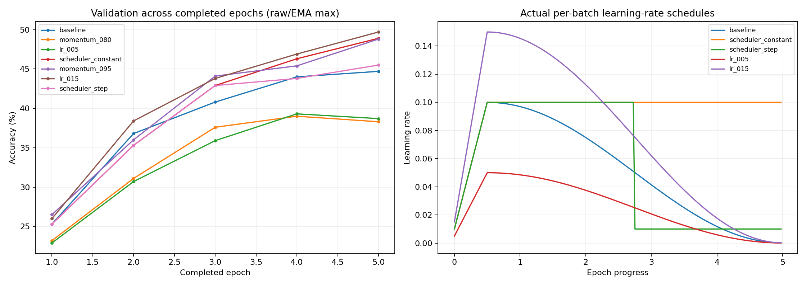

# So sánh nhanh momentum, initial LR và scheduler

**Đây là thực nghiệm ngắn trên validation CIFAR-10, không phải kết quả test hoặc bằng chứng tối ưu cho 600 epoch.**

## Cách chạy

- CompactMix-L gốc: 5,248,172 tham số; 0.842406944 GFLOPs/ảnh.
- 5,000 ảnh train và 1,000 ảnh validation, lấy cân bằng từng lớp từ split 45k/5k, không giao nhau.
- Mỗi cấu hình khởi tạo mới cùng seed 42, split seed 2026, batch 128, 5 epoch; chỉ đổi một yếu tố so với baseline.
- Hoàn thành 7 cấu hình trong 6.96 phút (không tính chuẩn bị, đo tốc độ ban đầu và xuất báo cáo).
- Cùng SGD + Nesterov=True, weight decay 0,0005 (trừ nhóm bias/BN), AutoAugment, Mixup/CutMix, smoothing 0,05, EMA, AMP và DropPath.
- Warmup thực tế = min(5, epochs/10) = **0.5 epoch**: LR từ 10% lên 100% base LR. Đây không phải warmup 5 epoch của run 600 epoch.
- Cosine giảm về 0,001×base LR; constant giữ base LR sau warmup; step giảm ×0,1 ở giữa đoạn sau warmup. Hai lịch constant/step chỉ thêm trong script thử nghiệm, không thay trainer gốc.
- Với lịch ngắn dưới 10 epoch, code gốc không có đoạn cuối tắt Mixup/CutMix; kết quả không mô phỏng đầy đủ recipe 600 epoch.
- Best chọn theo validation raw/EMA như engine gốc; có cả số cuối epoch để nhìn độ ổn định. Chỉ giữ best.pt và last.pt cho mỗi run.
- GPU: NVIDIA GeForce RTX 4060 Laptop GPU; Python 3.13.14, PyTorch 2.7.1+cu118.

## Kết quả đo

| Cấu hình | Momentum | Base LR | Scheduler | Best val % | Δ so baseline (điểm %) | Epoch/weights best | Val raw cuối % | Val EMA cuối % | Raw loss cuối | AMP skips |
|---|---:|---:|---|---:|---:|---|---:|---:|---:|---:|
| baseline | 0.9 | 0.1 | cosine | 44.70 | +0.00 | 5/raw | 44.70 | 44.00 | 1.5389 | 0 |
| momentum_080 | 0.8 | 0.1 | cosine | 39.00 | -5.70 | 4/raw | 38.30 | 38.20 | 1.6738 | 0 |
| lr_005 | 0.9 | 0.05 | cosine | 39.30 | -5.40 | 4/ema | 38.60 | 38.70 | 1.7030 | 0 |
| scheduler_constant | 0.9 | 0.1 | constant | 48.90 | +4.20 | 5/ema | 44.00 | 48.90 | 1.5291 | 0 |
| momentum_095 | 0.95 | 0.1 | cosine | 48.80 | +4.10 | 5/raw | 48.80 | 48.30 | 1.4866 | 0 |
| lr_015 | 0.9 | 0.15 | cosine | 49.70 | +5.00 | 5/raw | 49.70 | 48.80 | 1.4671 | 0 |
| scheduler_step | 0.9 | 0.1 | step | 45.50 | +0.80 | 5/raw | 45.50 | 44.70 | 1.5364 | 0 |




## Có thể giải thích lựa chọn trong bài như thế nào?

- **momentum:** trong phép thử này, mức `0.95` có best validation cao nhất (48.80%). Baseline đạt 44.70%. Nếu có điểm bằng nhau thì không kết luận hơn/kém.
- **base_lr:** trong phép thử này, mức `0.15` có best validation cao nhất (49.70%). Baseline đạt 44.70%. Nếu có điểm bằng nhau thì không kết luận hơn/kém.
- **scheduler:** trong phép thử này, mức `constant` có best validation cao nhất (48.90%). Baseline đạt 44.70%. Nếu có điểm bằng nhau thì không kết luận hơn/kém.

> Em chọn SGD momentum 0,9, base LR 0,1 và cosine làm cấu hình nền. Momentum giúp tích lũy hướng gradient; warmup giảm bước cập nhật ban đầu; cosine giảm LR để tinh chỉnh về cuối. Em đã chạy thêm các cấu hình đối chiếu trên cùng tập con và ngân sách. Bảng cho thấy kết quả học ban đầu; em không dùng nó để khẳng định cấu hình gốc tối ưu cho toàn bộ quá trình train.

Nếu baseline không đứng đầu ở một yếu tố, trình bày đúng rằng mức khác học tốt hơn trong phép thử ngắn. Không đổi kết quả hoặc viết lý do để biến cấu hình đã chọn thành người thắng.

## Giới hạn và cách đọc

- Một seed, ít ảnh và ít epoch: thứ hạng có thể thay đổi khi train dài hoặc đổi seed. Chênh lệch nhỏ chưa chứng minh lợi ích ổn định.
- So sánh scheduler đồng thời thay đổi tổng mức LR tích lũy; đây là so sánh toàn bộ lịch, không tách riêng hình dạng khỏi tổng bước cập nhật.
- AMP có thể bỏ cập nhật nếu gradient không hữu hạn; cột AMP skips công khai số lần, nên cùng số batch không luôn đồng nghĩa cùng số cập nhật thành công.
- Không mở official test; không gán các số này cho điểm test 97,18%/82,98%. Không có kết luận mới cho CIFAR-100 hoặc Adam.
- Thử nghiệm tập con này không hoàn thành yêu cầu SGD/Adam và nhiều LR trên cả hai dataset của Final exam.docx.

## File và lệnh tái lập

- CSV: [THU_NGHIEM_NHANH_MOMENTUM_LR_SCHEDULER.csv](THU_NGHIEM_NHANH_MOMENTUM_LR_SCHEDULER.csv); JSON có split indices, config, environment, source hash và đầy đủ history: [THU_NGHIEM_NHANH_MOMENTUM_LR_SCHEDULER.json](THU_NGHIEM_NHANH_MOMENTUM_LR_SCHEDULER.json).
- Run/checkpoint/log: `experiments/quick_recipe_20261016_5epoch/<variant>/`.
- Split SHA256: `46fb889a2cd8a382bbf06462aefde0e70202a9a78f215e19ba7247cfe7062bac`; initial weights SHA256: `dabf2f0792f9a29b939a89d3a1b7db02523de2e5efc1d3a3243af20fff570f97`.
- Lượt đo tốc độ ban đầu 8 epoch trong `experiments/quick_recipe_20261016` đã dừng sớm, giữ checkpoint nhưng không đưa vào bảng. Chỉ các run hoàn chỉnh cùng ngân sách ở thư mục 5epoch được so sánh.

```powershell
& 'C:\Users\anhna\AppData\Local\Microsoft\WindowsApps\python3.13.exe' -X utf8 -u scripts/run_quick_recipe_comparison.py --epochs 5 --output experiments/quick_recipe_20261016_5epoch --budget-seconds 660
```

Chạy lại đúng lệnh sẽ dùng checkpoint cùng source/config; đổi recipe/source thì chọn --output mới. Không cần tạo môi trường Python khác.
