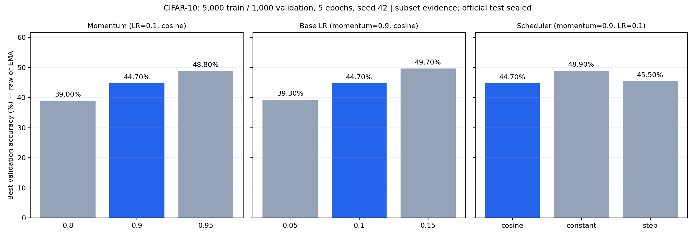

# Quick recipe comparisons

Seven controlled CIFAR-10 runs: **5 epochs**, the same balanced **5,000 training /
1,000 validation** subset, seed 42, split seed 2026, batch 128 and original model.
Each row changes one setting from SGD momentum 0.9, base LR 0.1 and cosine.
Measured suite time: 417.59 seconds.

| Change from baseline | Best validation |
|---|---:|
| Baseline |44.70% |
| Momentum0.8 |39.00% |
| Momentum0.95 |48.80% |
| Base LR 0.05 |39.30% |
| Base LR 0.15 |49.70% |
| Constant LR after warmup |48.90% |
| Step LR after warmup |45.50% |

Best uses raw/EMA validation consistently with the original trainer.
[metrics.csv](metrics.csv) includes final raw/EMA accuracy, loss and AMP skips.
[evidence.json](evidence.json) retains exact split/configs, source identity,
environment and per-epoch histories. No official test was opened.

Warmup was 0.5 epoch by `min(5, epochs/10)`. Constant holds base LR; step reduces
it by 0.1 halfway through the post-warmup interval. All settings shared the same
augmentation/mixing/smoothing/EMA recipe. No final no-mixing tail exists in this
five-epoch schedule. Scheduler changes also change cumulative LR exposure.

These are **short-run subset results**, not a full-data 600-epoch ranking or the
required SGD/Adam comparison on both datasets. Original settings did not win.
One seed and a small validation set do not establish stable gains or justify
combining winners without a new experiment. The temporary comparison runner was
removed during cleanup; these records preserve the measured evidence.

